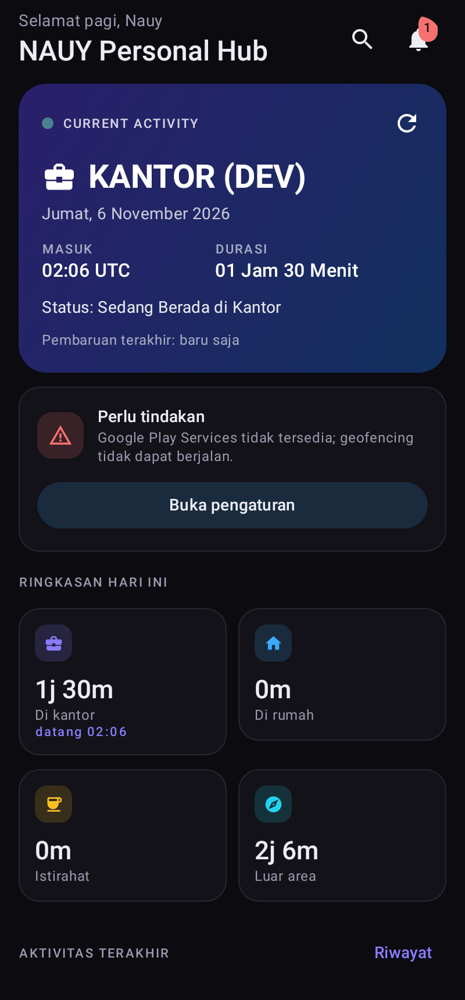
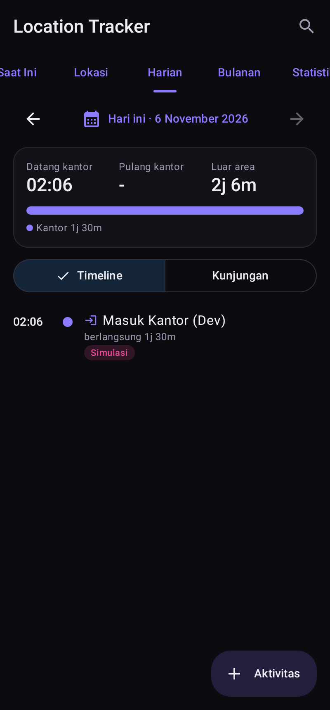
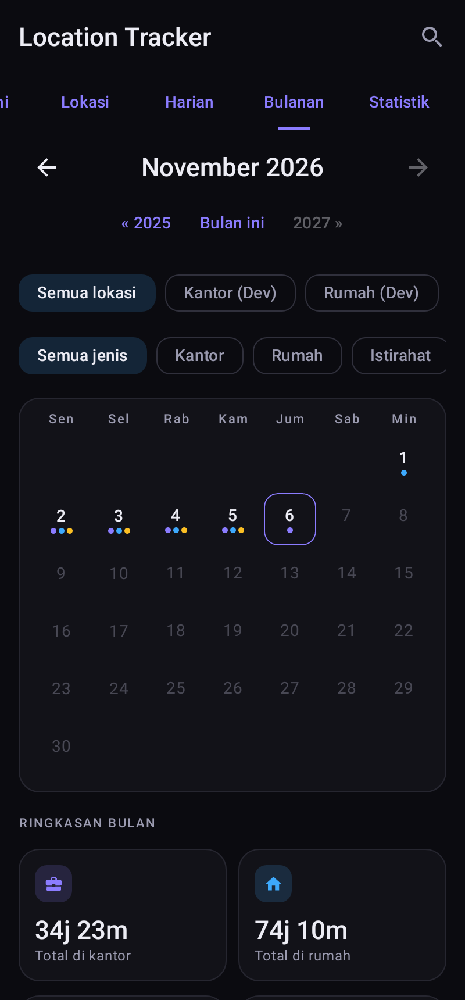
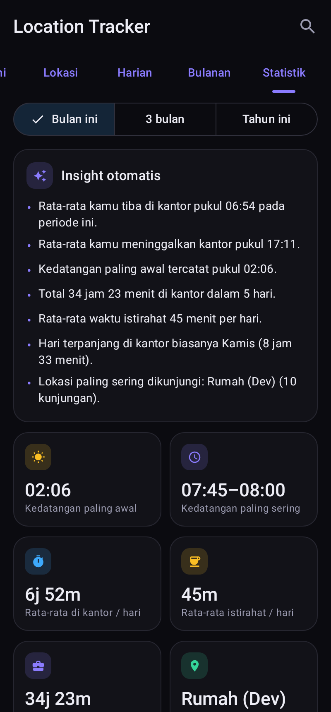
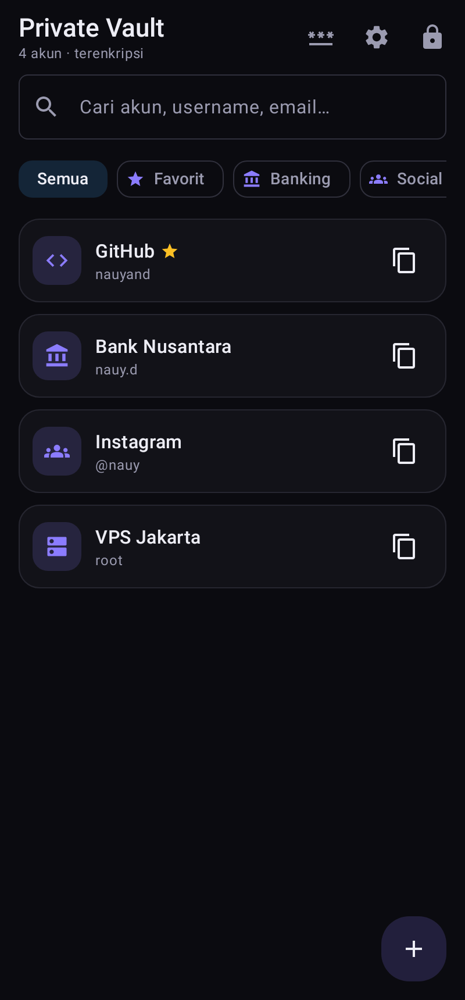
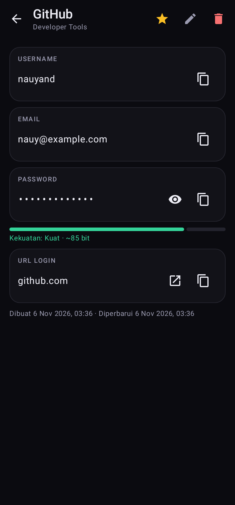
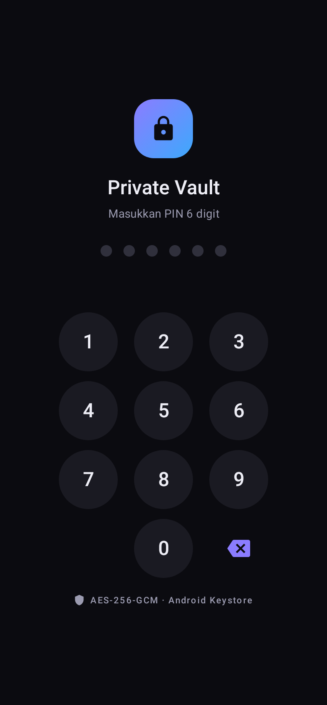
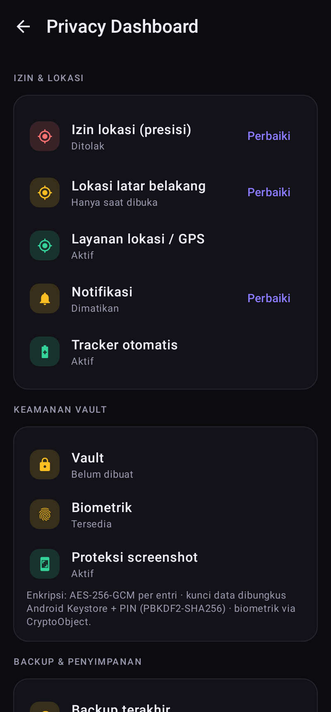

# NAUY Personal Hub

Aplikasi Android pribadi yang menggabungkan **Smart Location Tracker** (geofencing otomatis: kapan datang ke
kantor, istirahat, pulang ke rumah) dan **Private Password Vault** (akun & password terenkripsi AES-256-GCM,
dilindungi PIN dan sidik jari). Semua data disimpan **lokal di perangkat**.

Kotlin · Jetpack Compose (Material 3) · Room · WorkManager · Play Services Location (Geofencing) ·
AndroidX Biometric · Android Keystore · osmdroid (OpenStreetMap) · kotlinx.serialization

Package `com.teknosolvo.personalhub` · minSdk 26 (Android 8.0) · targetSdk 35 (Android 15) · AGP 8.7.3 ·
Kotlin 2.0.21 · Gradle 8.11.1

| Dashboard | Timeline harian | Kalender bulanan | Statistik |
|---|---|---|---|
|  |  |  |  |
| **Vault** | **Detail akun** | **Kunci PIN / biometrik** | **Privacy Dashboard** |
|  |  |  |  |

> Screenshot dirender otomatis oleh `ScreenRenderTest` (Robolectric) dengan data simulasi.

---

## 1. Ringkasan perubahan dari aplikasi lama

Repo ini sebelumnya berisi **Absensi** — simulasi absensi karyawan dengan selfie (CameraX) + GPS, satu titik
kantor di SharedPreferences, satu tabel Room `attendance`.

| Bagian lama | Keputusan |
|---|---|
| Kotlin + Compose + Material 3 + Room + KSP + Navigation | **Dipertahankan** (masih modern & layak). |
| `play-services-location`, `LocationHelper` (fused location, deteksi mock, geocoder) | **Dipertahankan & dikembangkan** menjadi `LocationProvider`; deteksi fake GPS kini dipakai mesin deteksi. |
| Konsep "radius kantor" | **Diperluas** menjadi banyak lokasi dengan radius bebas + geofencing otomatis. |
| CameraX, selfie, watermark foto, pendaftaran karyawan/NIP, status terlambat | **Dihapus** (tidak relevan untuk aplikasi pribadi). |
| SharedPreferences settings | **Diganti** tabel Room `app_settings` / `security_settings`. |
| Package `com.teknosolvo.absensi` | Diganti `com.teknosolvo.personalhub` (aplikasi baru, bisa terpasang berdampingan). |

Ditambahkan: WorkManager, AndroidX Biometric, Fragment (untuk BiometricPrompt), lifecycle-process (auto-lock
saat background), osmdroid (peta tanpa API key), kotlinx.serialization (backup), Robolectric + Compose UI test.

## 2. Struktur project

```
app/src/main/java/com/teknosolvo/personalhub/
├── PersonalHubApp.kt          Application: init container, channel notifikasi, auto-lock saat background
├── AppContainer.kt            Dependency container (DB, repositori, geofence, vault, backup)
├── MainActivity.kt            FragmentActivity (BiometricPrompt) + deteksi interaksi untuk auto-lock
├── data/
│   ├── Entities.kt            Place, LocationEvent, DailyActivity, TrackerState, VaultAccount, VaultCategory,
│   │                          QuickNote, AppSettingEntry, SecuritySettings, AppNotification
│   ├── Daos.kt                DAO Room per entitas
│   ├── HubDatabase.kt         Room DB (+ seed 10 kategori vault)
│   └── SettingsRepository.kt  Preferensi aplikasi (tabel app_settings)
├── tracking/
│   ├── PresenceEngine.kt      ★ Mesin deteksi murni: dwell time, hysteresis, filter akurasi/mock/lompatan
│   ├── TrackerRepository.kt   Menerapkan hasil engine ke DB, merge kunjungan, koreksi manual, notifikasi
│   ├── GeofenceManager.kt     Registrasi geofence OS (Play Services)
│   ├── LocationProvider.kt    Izin, status GPS, one-shot fix, reverse geocoding
│   ├── TrackingWork.kt        GeofenceReceiver, BootReceiver, ConfirmWorker, PeriodicCheckWorker
│   └── Stats.kt               Ringkasan harian/bulanan, rata-rata datang/pulang, insight otomatis
├── vault/
│   ├── CryptoBox.kt           AES-256-GCM + PBKDF2-HMAC-SHA256 (JCE)
│   ├── KeystoreKeys.kt        Kunci Android Keystore (device wrap + kunci biometrik/CryptoObject)
│   ├── VaultSession.kt        Kunci data di memori, auto-lock (inaktif & background)
│   ├── VaultRepository.kt     PIN, lockout, biometrik, CRUD akun terenkripsi
│   ├── PasswordGenerator.kt   Generator SecureRandom + estimasi kekuatan
│   └── SecureClipboard.kt     Salin sensitif + hapus clipboard otomatis
├── backup/BackupManager.kt    Backup/restore terenkripsi (.nhb)
├── report/ReportExporter.kt   Ekspor CSV & PDF
├── notify/Notifier.kt         Notification channel + Notification Center
├── util/Format.kt             Format tanggal/durasi (id-ID, WIB/WITA/WIT)
└── ui/
    ├── theme/                 Tema charcoal + aksen ungu / electric blue (gelap default, terang, sistem)
    ├── components/            Kartu, PIN pad, dialog tanggal/jam, FLAG_SECURE, alur izin lokasi
    ├── nav/AppRoot.kt         Bottom navigation 5 tab + semua rute
    ├── dashboard/             Dashboard, onboarding, notification center
    ├── tracker/               Saat Ini, Lokasi (+ peta), Harian, Bulanan, Statistik, editor aktivitas
    ├── vault/                 Gate PIN/biometrik, daftar, detail, editor, generator, vault settings
    ├── personal/              Quick Notes, Activity Notes, Export Report
    ├── settings/              Setelan, GPS, notifikasi, tema, backup, privacy dashboard, simulasi
    └── search/                Pencarian global
app/src/debug/…/DevTools.kt    Seeder data dummy — HANYA build debug
app/src/release/…/DevTools.kt  Stub kosong untuk rilis (tidak ada data dummy di APK rilis)
app/src/test/…                 60+ unit/Robolectric test + render 20 layar
app/schemas/                   Skema Room yang diekspor (untuk migrasi berikutnya)
```

### Navigasi

| Tab | Isi |
|---|---|
| **Beranda** | Current Activity, status GPS/izin, ringkasan hari ini, aktivitas terakhir, grafik 7 hari, akses cepat, pencarian global, notification center |
| **Tracker** | Saat Ini · Lokasi · Harian · Bulanan · Statistik |
| **Vault** *(terkunci)* | Semua akun, filter kategori & favorit, generator, vault settings |
| **Personal** | Quick Notes · Activity Notes · Export Report |
| **Setelan** | PIN & Biometrik · GPS & Tracker · Notifikasi · Tema · Backup & Restore · Privacy & Security · Simulasi |

## 3. Fitur yang sudah berfungsi

### Smart Location Tracker
- Kelola lokasi: tambah, ubah, hapus, aktif/nonaktif; nama, **jenis** (Kantor/Rumah/Istirahat/Tempat Makan/Lainnya),
  **ikon** (12 pilihan), **warna** (9), **radius bebas** (slider 20–1000 m atau input angka hingga 5000 m).
- Ambil koordinat dari **lokasi saat ini** atau **ketuk di peta** (OpenStreetMap, lingkaran radius tampil langsung), atau ketik manual.
- **Deteksi otomatis** via Geofencing API: OS membangunkan aplikasi saat melewati batas, lalu `PresenceEngine` memutuskan.
- **Anti-duplikasi & akurasi**:
  - *Dwell time* (default 3 mnt): masuk dicatat hanya jika tetap di dalam; waktu masuk = fix pertama di dalam.
  - *Exit delay* (default 3 mnt) + *hysteresis* (radius + toleransi, default 30 m): GPS memantul di tepi tidak memicu keluar/masuk berulang.
  - Fix dengan akurasi buruk (> 200 m), **lokasi palsu (mock)**, fix basi, dan **lompatan tidak wajar** (> 75 m/s) diabaikan.
  - Kembali ke lokasi yang sama dalam 10 menit → kunjungan **digabung**, bukan dobel.
  - Event OS ganda dicatat sebagai *DUPLICATE* di log, tanpa membuat aktivitas baru.
  - Semua parameter bisa diatur di Setelan → GPS & Tracker.
- Disimpan: nama lokasi, waktu masuk, waktu keluar, durasi, tanggal, status deteksi (log `location_events` lengkap).
- **Dashboard Current Activity**: lokasi, tanggal, jam masuk + zona (WIB/WITA/WIT), durasi live, status
  ("Sedang Berada di Kantor" / "Di Luar Area Terdaftar" / "menunggu konfirmasi"), waktu pembaruan terakhir, status GPS & izin.
- **Riwayat harian**: timeline (Masuk/Keluar/Istirahat) atau daftar kunjungan; navigasi tanggal; ringkasan datang/pulang/luar area.
- **Koreksi manual**: tambah aktivitas terlewat, ubah jam masuk/keluar (termasuk lewat tengah malam), ganti lokasi,
  hapus, catatan pribadi. Penanda **Manual** / **Dikoreksi** / **Simulasi**.
- **Riwayat bulanan**: kalender interaktif dengan titik warna per jenis, detail per tanggal, filter lokasi/jenis,
  navigasi bulan & tahun; total kantor/rumah/istirahat/luar area, rata-rata datang & pulang, hari di kantor,
  hari tanpa aktivitas; grafik harian & mingguan.
- **Statistik & insight**: kedatangan paling awal, slot kedatangan paling sering (15 menit), rata-rata di kantor & istirahat,
  total bulan ini, lokasi paling sering, pola mingguan, kalimat insight otomatis
  (mis. *"Rata-rata kamu tiba di kantor pukul 08:10 pada periode ini."*).

### Private Vault
- PIN 4/6/8 digit, **sidik jari/biometrik** (BiometricPrompt + CryptoObject), bisa diaktifkan/nonaktifkan.
- Lockout bertingkat setelah 5 PIN salah (30 dtk, 60 dtk, … maks. 1 jam).
- **Auto-lock** saat tidak digunakan (30 dtk–15 mnt/mati) dan **saat aplikasi ke background**.
- **FLAG_SECURE** (blokir screenshot, perekaman layar, dan pratinjau Recent Apps) di semua layar vault.
- Opsi **kunci seluruh aplikasi** dengan PIN/biometrik yang sama.
- Akun: nama aplikasi/website, kategori (10 bawaan + kustom), username, email, password, URL login, catatan,
  tanggal dibuat & diperbarui, favorit.
- Password tersembunyi secara default; tombol tampilkan/sembunyikan; salin username/email/password/URL;
  clipboard ditandai sensitif dan **dihapus otomatis** (default 30 dtk).
- Pencarian, filter kategori, favorit, detail, edit, hapus, meter kekuatan password.
- **Generator** (SecureRandom): panjang 8–64, kapital, kecil, angka, simbol, hindari karakter mirip.

### Fitur tambahan
- **Quick Notes** (Pekerjaan/Ide/Pengingat/Penting, sematkan, cari).
- **Activity Notes**: catat aktivitas pribadi di luar lokasi terdaftar + semua aktivitas bercatatan.
- **Notification Center**: masuk/keluar kantor & rumah (lokasi lain opsional), GPS mati, izin dicabut, masalah geofence.
- **Pencarian global**: riwayat, lokasi, catatan, dan akun vault (hanya saat vault terbuka).
- **Export Report**: CSV (UTF-8 BOM, siap Excel) atau PDF dengan filter rentang tanggal/bulan, lokasi, jenis.
- **Privacy Dashboard**: izin lokasi, background location, GPS, notifikasi, status vault, biometrik,
  proteksi screenshot, backup terakhir, ukuran database & jumlah data.
- **Backup & Restore** terenkripsi, **hapus seluruh data** dengan konfirmasi.
- **Simulasi & pengujian** di dalam aplikasi: simulasi masuk/keluar geofence, uji event ganda, uji GPS goyah
  (180 fix), seeder data dummy (debug saja), hapus data simulasi.
- Tema gelap (default), terang, ikuti sistem; aksen ungu atau electric blue; animasi transisi.

## 4. Fitur yang belum selesai / keterbatasan

- **Belum diuji di perangkat fisik/emulator** di lingkungan pengembangan ini (tidak ada akselerasi emulator).
  Logika diverifikasi lewat unit test + Robolectric, dan semua layar dirender tanpa crash. Uji di HP asli tetap wajib,
  terutama geofencing latar belakang dan sidik jari.
- **Android Keystore & BiometricPrompt asli** tidak bisa dijalankan di JVM; test memakai implementasi pengganti
  berbasis JCE dengan antarmuka yang sama.
- **Data lokasi/catatan tidak dienkripsi di level database** (hanya vault yang dienkripsi per entri). Data berada di
  penyimpanan privat aplikasi dan dikecualikan dari backup cloud. Opsi lanjutan: SQLCipher untuk seluruh DB.
- **Peta** butuh internet untuk memuat tile OSM (koordinat tetap bisa diambil dari GPS/manual secara offline).
- Tidak ada sinkronisasi cloud (disengaja — data pribadi tidak dikirim ke server pihak ketiga).
- Notifikasi dari lokasi selain kantor/rumah default **mati** (bisa dinyalakan).
- Release APK perlu keystore penandatangan milikmu sendiri (lihat bagian 6).

## 5. Cara menjalankan

1. Android Studio Ladybug (2024.2) atau lebih baru, JDK 17+.
2. Buka folder repo, tunggu Gradle sync, jalankan konfigurasi **app** (varian `debug`).
3. Ikuti onboarding: beri izin lokasi → **"Izinkan sepanjang waktu"** → notifikasi.
4. Tracker → Lokasi → **+ Lokasi**: buat "Kantor" (radius mis. 100 m) dan "Rumah" (150 m).
5. Vault → buat PIN → (opsional) aktifkan sidik jari.

Uji tanpa berpindah tempat: Setelan → GPS & Tracker → **Simulasi & pengujian**, atau di emulator gunakan
*Extended controls → Location* untuk memindahkan titik (pastikan Google Play Services ada di image emulator).

### Menjalankan test

```bash
./gradlew testDebugUnitTest
```

Mencakup `PresenceEngineTest` (dwell, hysteresis, jitter, mock, lompatan, merge), `StatsTest`, `TrackerRepositoryTest`
(Room in-memory: simpan waktu, anti-duplikasi, urutan harian, koreksi manual, simulasi), `VaultRepositoryTest`
(PIN, lockout, enkripsi tanpa plaintext di DB, auto-lock, biometrik + invalidasi, ganti PIN, wipe),
`BackupAndBootTest` (backup terenkripsi, restore ke "perangkat baru", password salah, re-register geofence setelah reboot),
`CryptoAndGeneratorTest`, dan `ScreenRenderTest` (render 20 layar ke `app/build/screenshots/`).

## 6. Cara build APK

```bash
./gradlew assembleDebug
```

Hasil: `app/build/outputs/apk/debug/app-debug.apk` (application id `com.teknosolvo.personalhub.debug`, berisi seeder dev).

APK rilis (diperkecil R8, ±3 MB, tanpa data dummy). Buat keystore sekali:

```bash
keytool -genkeypair -v -keystore nauyhub-release.jks -alias nauyhub -keyalg RSA -keysize 4096 -validity 10000
```

Lalu buat `keystore.properties` di root project (sudah di-*gitignore*):

```properties
storeFile=nauyhub-release.jks
storePassword=********
keyAlias=nauyhub
keyPassword=********
```

```bash
./gradlew assembleRelease
```

Hasil: `app/build/outputs/apk/release/app-release.apk`. Tanpa `keystore.properties`, Gradle membuat
`app-release-unsigned.apk` yang harus ditandatangani dengan `apksigner` sebelum dipasang.

## 7. Izin & keamanan

Detail lengkap ada di [docs/SECURITY.md](docs/SECURITY.md). Ringkasnya:

| Izin | Untuk apa |
|---|---|
| `ACCESS_FINE_LOCATION`, `ACCESS_COARSE_LOCATION` | Membaca posisi, memilih titik lokasi, geofencing |
| `ACCESS_BACKGROUND_LOCATION` | Deteksi masuk/keluar saat aplikasi tertutup / layar mati (diminta terpisah, sesuai aturan Android 11+) |
| `RECEIVE_BOOT_COMPLETED` | Mendaftarkan ulang geofence setelah HP restart / aplikasi diperbarui |
| `POST_NOTIFICATIONS` | Notifikasi aktivitas & masalah GPS (Android 13+) |
| `USE_BIOMETRIC` | Membuka vault dengan sidik jari |
| `INTERNET`, `ACCESS_NETWORK_STATE` | Hanya tile peta OpenStreetMap dan (opsional) nama alamat dari Geocoder |

- Vault: kunci data acak AES-256 → dibungkus **Android Keystore** lalu **PIN (PBKDF2-HMAC-SHA256, 120k iterasi)**;
  salinan kedua dibungkus kunci Keystore **khusus biometrik** (wajib autentikasi setiap pemakaian, batal jika sidik jari baru didaftarkan).
- Setiap akun dienkripsi **AES-256-GCM** (IV acak 96-bit, tag 128-bit, AAD); judul akun pun ikut terenkripsi.
- PIN, password, dan kunci **tidak pernah ditulis ke log**; `allowBackup=false` + aturan ekstraksi data
  mengecualikan semua data dari backup cloud/transfer perangkat.
